# AVA Knight Lore

[](https://github.com/Harlock123/AVAKnightLore/actions/workflows/build.yml)

An isometric 3D adventure in the style of Ultimate Play the Game's 1984 ZX Spectrum game **Knight Lore**,
built with .NET 10 and Avalonia UI. Sabreman is cursed: each night he turns into a wolf. The wizard
Melkhior can cure him, if he brings the charms the cauldron asks for, one at a time and in daylight, within
forty days. The wizard will not abide the wolf.

## Features

- **Isometric rooms**, drawn back to front: stone floors, blocks to climb, back walls with arched doorways,
  and everything in the room (Sabreman, guards, spiked balls, charms, the cauldron) sorted into place.
- **Three castles**, each larger with more charms to find: The Castle of Melkhior (16 rooms, 5 charms),
  The Tower of Night (20 rooms, 6) and The Keep of the Curse (25 rooms, 7). The cauldron is in the middle of
  each.
- **Every room is proved:** it's built from a seed, then the game works out every place Sabreman can stand
  and where each walk or jump takes him, using its own physics. A room is kept only if every doorway and its
  charm can be reached from every doorway, keeping off the guards' lines.
- **Rooms of every kind:** pillared halls; fields of spikes with blocks to step along; floors full of holes
  into the dark; raised walks and steps; guards pacing to and fro with spears; spiked balls bouncing on
  their squares.
- **Sabreman** walks the four ways along the room and jumps a fixed arc. He can jump up onto a block one
  high, or across a hole, but two blocks high is a wall. A charm up on a block needs a jump.
- **Day and night:** the sun and the moon cross the window below the room. At dusk he changes (frozen
  for a moment) into the wolf, and at dawn back again. Set foot in the wizard's room as the wolf and he
  strikes, after a moment's grace to get out.
- **The cauldron** wants one charm at a time, and shows which in a bubble over Melkhior's head. Carry any
  charms you find; drop in the one he wants by walking up to the cauldron. With every charm in, the curse
  is lifted, and the days left count as points.
- **The attract mode** shows the computer Sabreman at work. It goes for the wanted charm, or the cauldron
  with it in the pack, room by room by the fewest doors, picking up any charm it passes. In each room it
  plans the quickest way and keeps off the guards' lines where it can. It plays each move out on a copy of
  the castle first, waiting for the moment a guard or a ball wouldn't catch it. By night it keeps out of
  the wizard's way.

## Screenshots

| The title | The first room | Spikes |
|:---------:|:--------------:|:------:|
| 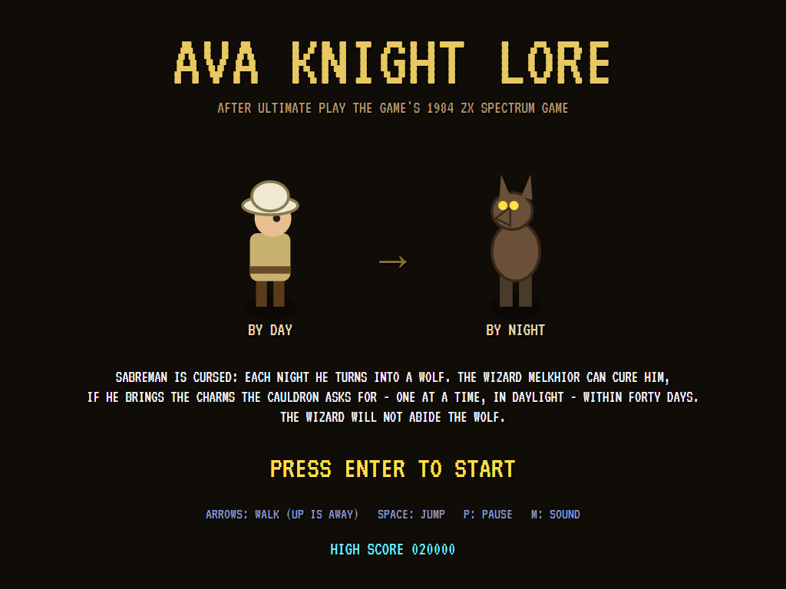 | 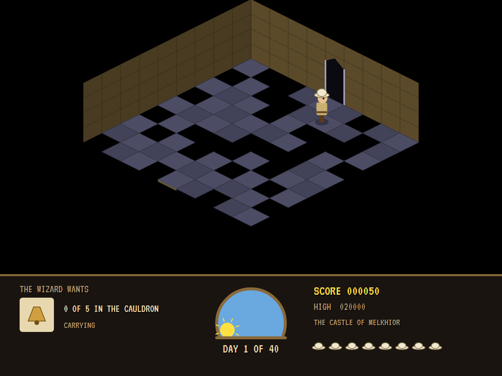 | 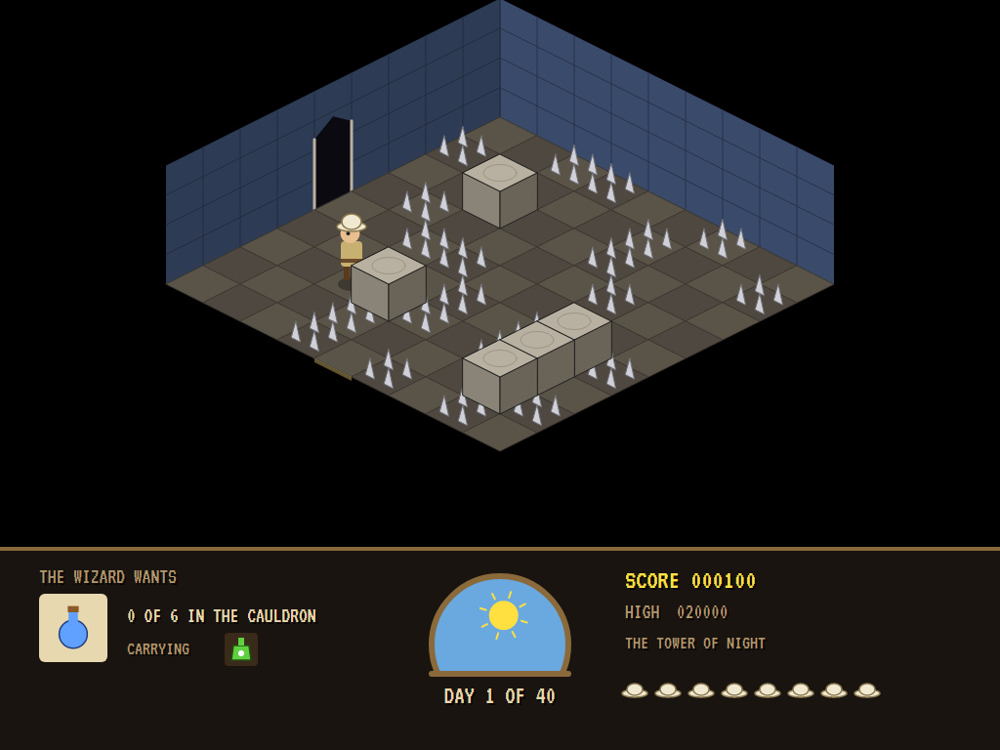 |
| By day, and by night. | Day one of forty. | Stepping stones. |

| Guards | Spiked balls | A charm |
|:------:|:------------:|:-------:|
| 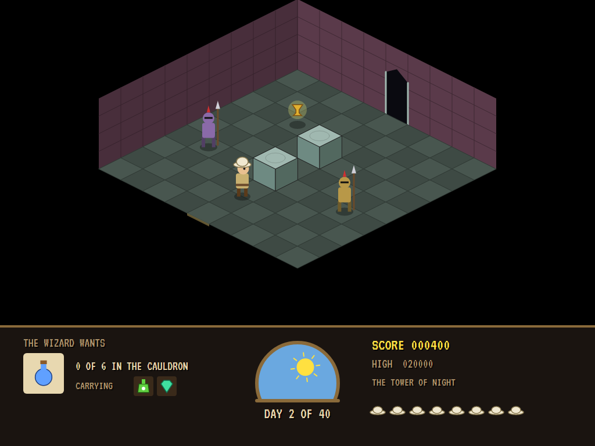 | 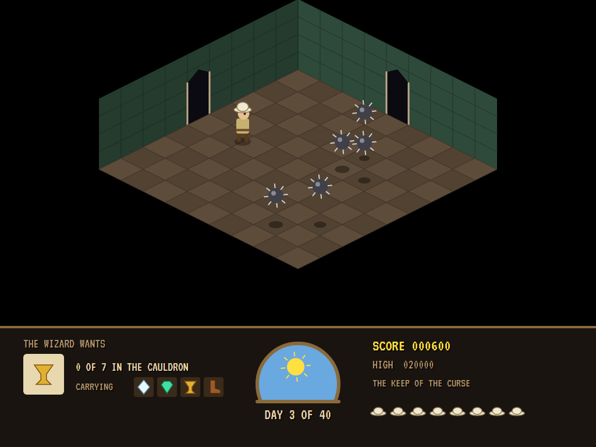 | 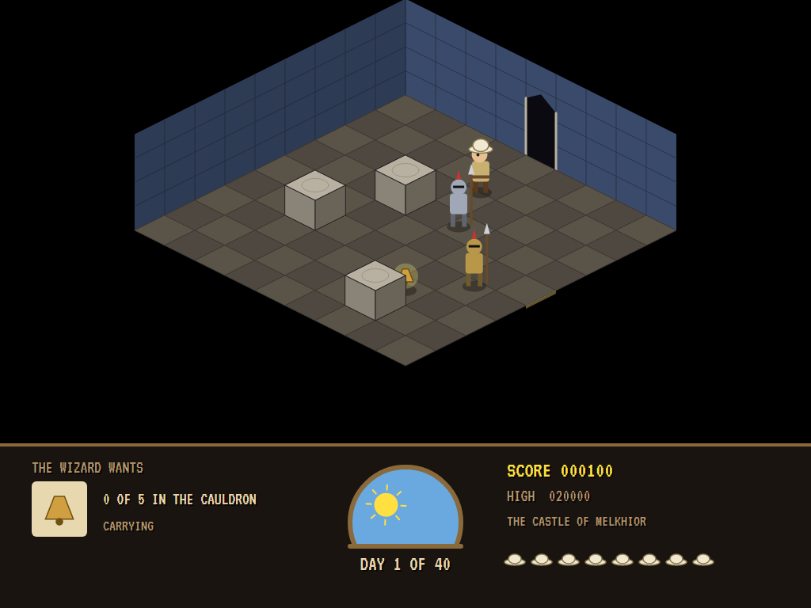 |
| Pacing their lines. | Bouncing on their squares. | Lying where it fell. |

| The cauldron | The wolf | Cured |
|:------------:|:--------:|:-----:|
| 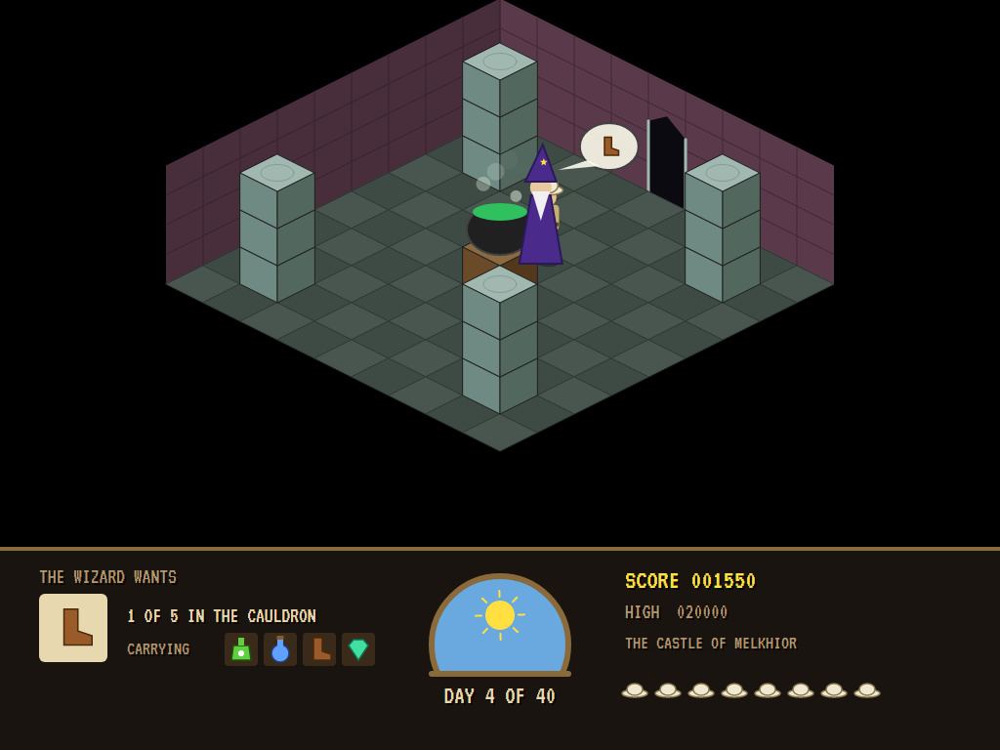 | 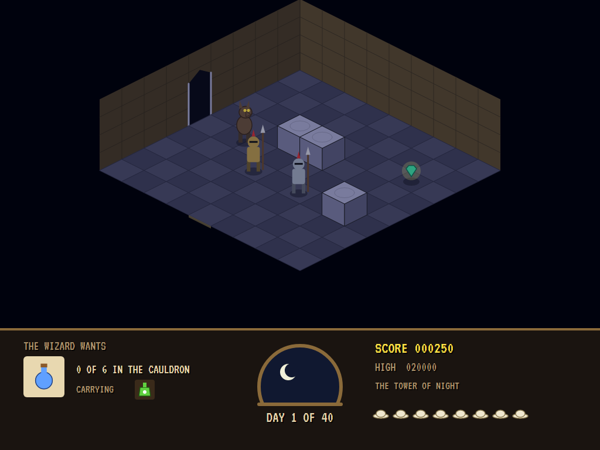 | 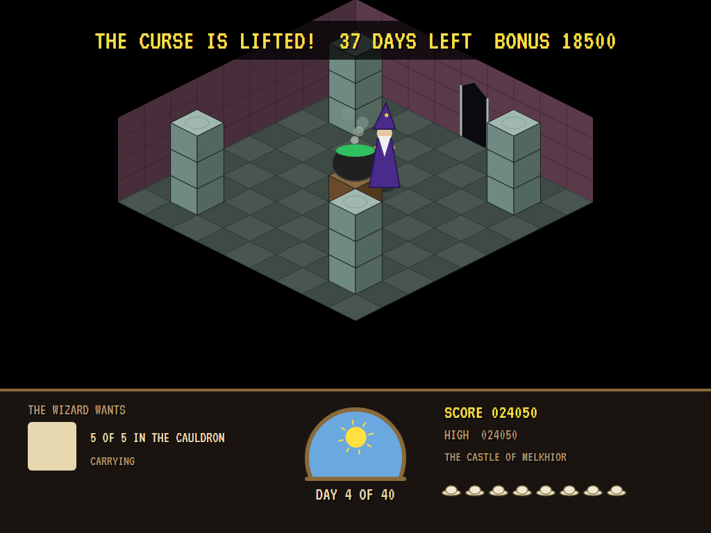 |
| Melkhior wants the boot. | Night falls. | The curse lifted. |

| Game over | The boldest adventurers |
|:---------:|:-----------------------:|
| 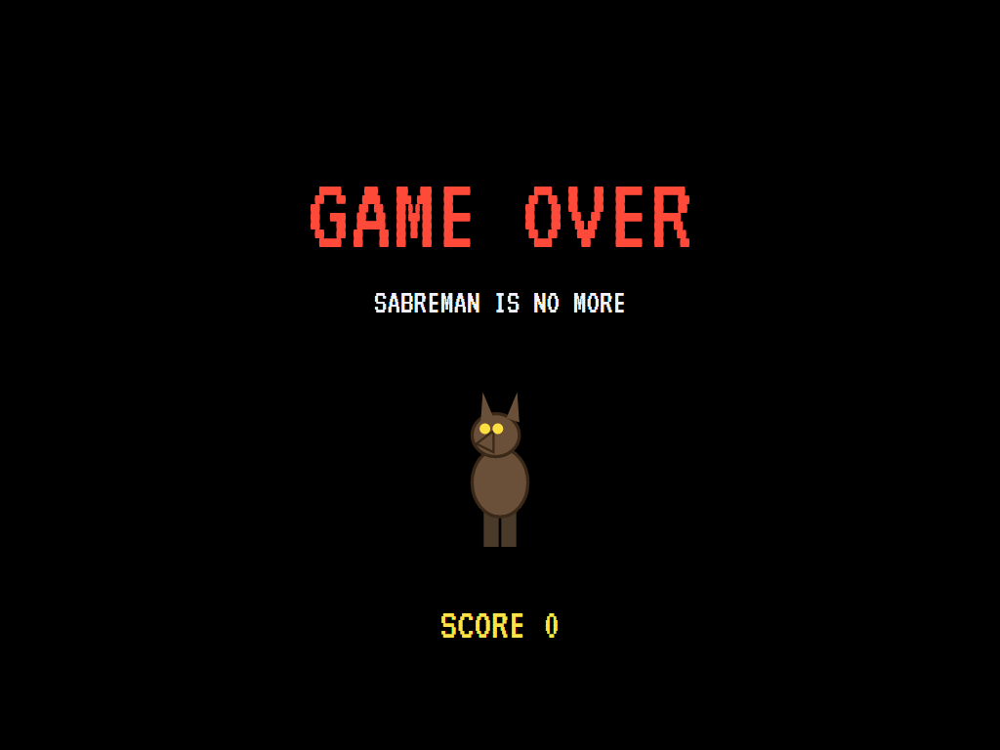 | 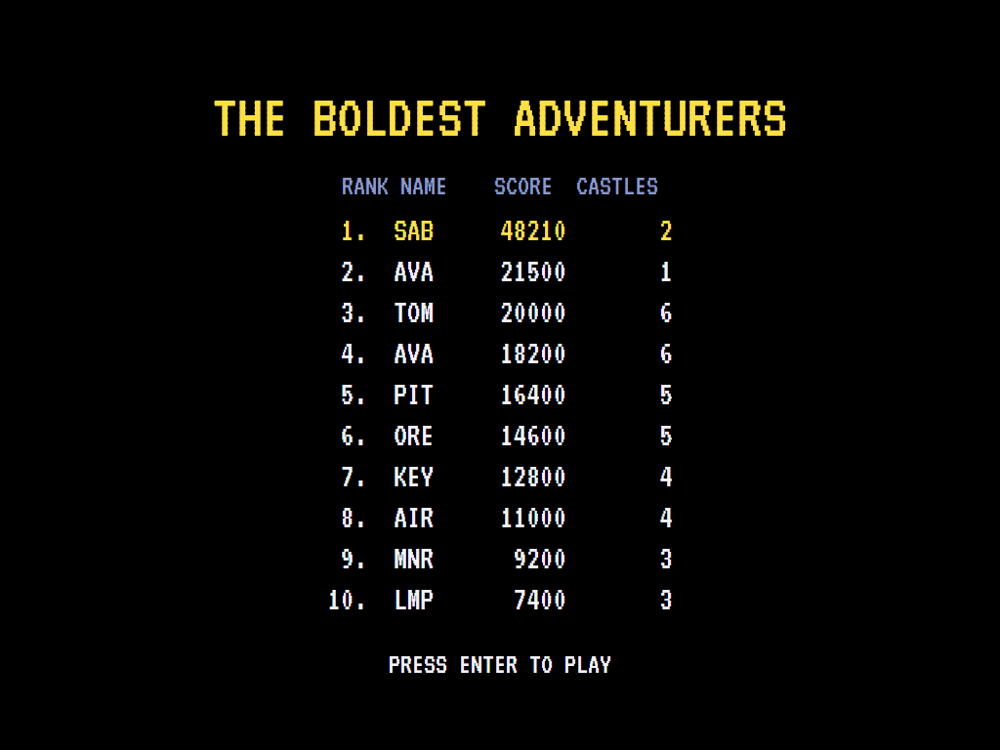 |

The screenshots are made by the tests, which play the game in a real (headless) window; see
[Tests](#tests).

## Download and run

Ready-to-run builds for Windows, macOS and Linux, on both Intel/AMD and ARM, are on the
[Releases page](https://github.com/Harlock123/AVAKnightLore/releases/tag/latest). **Latest build** is
rebuilt on every push to `main`. Each download is one self-contained executable: no .NET install is
needed.

| Platform | Archive |
|---|---|
| Windows | `AVAKnightLore-win-x64.zip`, `AVAKnightLore-win-x86.zip`, `AVAKnightLore-win-arm64.zip` |
| macOS | `AVAKnightLore-osx-arm64.tar.gz` (Apple silicon), `AVAKnightLore-osx-x64.tar.gz` (Intel) |
| Linux | `AVAKnightLore-linux-x64.tar.gz`, `AVAKnightLore-linux-arm64.tar.gz`, `AVAKnightLore-linux-arm.tar.gz` |

```bash
tar -xzf AVAKnightLore-linux-x64.tar.gz     # or linux-arm64, linux-arm, osx-arm64, osx-x64
./AVAKnightLore
```

On Windows, unzip and run `AVAKnightLore.exe`. On macOS, if Gatekeeper refuses to open it, run
`xattr -d com.apple.quarantine AVAKnightLore` once. Run with `--no-audio` for silence.

**Sound** comes through OpenAL Soft, built in for every platform. In a virtual machine the game
detects it and uses a larger audio buffer, so the sound doesn't break up.

**Gamepads** use SDL2, which is bundled for Windows, macOS and Intel/AMD Linux. ARM Linux builds need it
installed; without it the keyboard still works:

```bash
sudo apt install libsdl2-dev            # Debian / Ubuntu / Raspberry Pi OS
sudo pacman -S --needed sdl2-compat     # Arch / Omarchy
```

## Controls

| Action | Keyboard | Gamepad |
|---|---|---|
| Start | Enter or 1 | Start |
| Walk away (up the screen, to the right) | Up or W | Up |
| Walk towards you (down the screen, to the left) | Down or S | Down |
| Walk along the other way | Left/right or A/D | Left / right |
| Jump | Space, Z, X or Ctrl | A or B |
| Pause | P or Esc | Start or Back |
| Sound on/off | M | |
| Screenshot | Ctrl+S (to your Pictures folder) | |

Walk into a doorway to go through it (he lines himself up with it). On the high-score table, type your
initials, or use up/down and Space, then Enter.

## Tests

```bash
dotnet test AVAKnightLore.slnx
```

The game runs in fixed 60 Hz steps, so it plays the same at any frame rate. Everything that changes lives
in one world that can be copied. The tests check:

- **The castles:** every room reached, every doorway and charm got to, doors matching on both sides, the
  cauldron in the middle and no charm in the start's or the cauldron's room; each castle larger with more
  charms; guards, balls, spikes and holes all present. The computer Sabreman cures every castle, losing no
  more than two lives. Wandering aimlessly, the curse wins.
- **Walking and jumping:** a steady walk and a wall that stops him; a jump onto one block but not two;
  dropping off a block; a jump across a hole, and walking into one; spikes underfoot; one jump for a held
  button.
- **Doors, guards, balls:** through a door into the next room, lined up with it on the way; a guard pacing
  its line and catching him, but not up on a block; a spiked ball's bounce, and coming down on him.
- **Charms and the cauldron:** a charm picked up, and the cauldron taking the one it wants; a charm up on
  a block needing a jump; dusk, the change, and the wizard striking the wolf after a moment's grace; dawn
  and the days counted.
- **The game:** killed, back at the door he came in by; the curse lifted with the days left counted in,
  then the next castle; forty days gone; the last life, and the high-score table; the demonstration;
  pause; the keys, through to Sabreman.

`tests/AVAKnightLore.Tests/PilotProbe.cs` reports how the computer Sabreman gets on in each castle, for
tuning (`KNIGHT_PROBE=1`; `KNIGHT_PROBE=lazy` for a Sabreman who only wanders right and jumps).

The screenshot tests draw the real screen in a headless window. To refresh the README's pictures:

```bash
KNIGHT_SHOTS=$PWD/Images dotnet test tests/AVAKnightLore.Tests --filter ScreenshotTests
```

## Building

```bash
dotnet build AVAKnightLore.slnx
dotnet run --project src/AVAKnightLore
```

Needs the .NET 10 SDK. The sounds and tunes are made by `tools/make_sounds.py` (standard-library Python):
`python3 tools/make_sounds.py` rewrites `src/AVAKnightLore/Sounds`.

## Project structure

```
AVAKnightLore/
├── AVAKnightLore.slnx
├── src/AVAKnightLore/
│   ├── Engine/
│   │   ├── GameEngine.cs        # States, lives, castles in turn, the days, the title and demonstration
│   │   ├── Sim.cs               # The castle step by step: walking, jumping, doors, guards, balls, charms, day and night
│   │   ├── World.cs             # Everything that changes, kept together so it can be copied
│   │   ├── Castle.cs            # Rooms, how a castle is built and proved, and the three castles
│   │   ├── Graph.cs             # Every place to stand in a room, and where each move from it goes
│   │   ├── Pilot.cs             # The computer Sabreman (the demonstration, and the tests)
│   │   ├── HighScoreTable.cs, InitialsEntry.cs
│   │   ├── InputHandler.cs, ControllerManager.cs  # Keys and an SDL2 gamepad
│   │   └── SoundManager.cs      # Effects and tunes through OpenAL
│   ├── Audio/                   # The OpenAL engine (from the author's AVABand)
│   ├── Views/                   # The isometric drawing, Sabreman and the wolf, the window and the scroll
│   └── Sounds/                  # The synthesised effects and tunes
├── tests/AVAKnightLore.Tests/   # Castle, gameplay and screenshot tests
├── tools/make_sounds.py
└── Images/                      # Screenshots
```

## About and licence

AVA Knight Lore © 2026 Lonnie Watson, under the [MIT License](LICENSE).

*Knight Lore* © 1984 Ultimate Play the Game; the names *Knight Lore*, *Sabreman* and *Melkhior* belong to
their current owner. AVA Knight Lore is an independent, unofficial game in its style. Its castles, rooms,
graphics, sounds and code are its own; nothing is taken from the original game's program, graphics or
sound. The title tune is the traditional "Greensleeves". It is not affiliated with or endorsed by any
rights holder.
